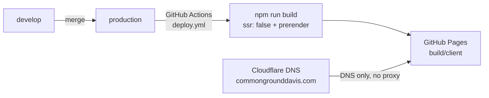

# Welcome to the Common Ground Davis web repo (commongrounddavis.com static webpage repo)

<p align="center">
  <a href="https://commongrounddavis.com">
    
  </a>
</p>


<p align="center">
  <strong><a href="https://commongrounddavis.com">commongrounddavis.com</a></strong>
</p>

[](LICENSE)


This repository powers the frontend code behind the Common Ground Davis [commongrounddavis.com](https://commongrounddavis.com) static website.

> This README is written for both technical and non-technical people — club background, who to contact, and how the site is built. If you're just here for the codebase and don't want the boring yada yada, skip straight to [Code Architecture and Getting Started](#code-architecture-and-getting-started).

## Table of contents

- [What is Common Ground Davis (CGD)?](#what-is-common-ground-davis-cgd)
  - [Condensed Mission Statement / About](#condensed-mission-statement--about)
  - [Full Mission Statement / About](#full-mission-statement--about)
  - [How the club was founded](#how-the-club-was-founded)
- [Repository Maintainers](#repository-maintainers)
  - [DNS / domain contact](#dns--domain-contact)
  - [Website content contact](#website-content-contact-until-june-2027)
- [Code Architecture and Getting Started](#code-architecture-and-getting-started)
  - [Infrastructure / Ownership](#infrastructure--ownership)
  - [Static Generation & GitHub Pages](#static-generation--github-pages)
  - [Cloudflare](#cloudflare)
- [Workflow](#workflow)
  - [Branches](#branches)
  - [Working on `develop`](#working-on-develop)
  - [Shipping to production](#shipping-to-production)
- [Development Notes](#development-notes)
  - [Getting Started](#getting-started)
  - [Building for Production](#building-for-production)
  - [Deployment](#deployment)
  - [Styling](#styling)

# What is Common Ground Davis (CGD)?

The most up-to-date info is at [commongrounddavis.com](https://commongrounddavis.com), but here is a copy of the same info below (it may not be current):


## Condensed Mission Statement / About

Common Ground Davis brings together UC Davis students who disagree politically, into structured debates built around the Steelman argument - before presenting an argument members must accurately present the strongest interpretation of the opposing argument and explain why a reasonable person may hold that beleif. We are founded & led by two co-leaders who disagree politically and we practice what we preach.

## Full Mission Statement / About

Common Ground Davis is a political debate club at UC Davis for students who disagree and want to understand each other.

Political polarization is a growing problem in the United States and at UC Davis. At the extremes of the right wing, empathy and opposing views are dismissed as "woke," "Marxist," "communist," or "mentally ill." On the far left, disagreement is immediately labeled "fascist," "violent speech," "Nazism," or "anti-human rights." Both sides dismiss honest questions from the other with labels that justify ignoring opposing views and keep people from hearing each other out.

We, at Common Ground Davis, want to change that status quo. We start from one belief: everyone has reasons behind their beliefs, and no one is inherently evil. People don't knowingly do something they believe is wrong without a reason. Either they believe it's the right thing to do, or they accept that it's wrong in isolation but justified in the broader context (e.g., breaking a rule to prevent a bigger harm). Everyone's reasons come from their own lived experiences, so the people we disagree with usually have genuine reasons for their beliefs, even if those reasons look flawed to us.

Whether a reason is good is a separate question from whether it exists, and you can't judge it fairly until you understand it. That's why, in our meetings, before a member argues their own side or presents a rebuttal, they must accurately present the strongest version of the opposing argument and explain why a reasonable person might hold it. This is the steelman argument, the direct inverse of the strawman argument. Strawmanning is a tempting shortcut: attacking a weaker / inaccurate version of the other side makes it easy to win a debate, but the victory is illusory and only deepens polarization. At Common Ground Davis, we practice the harder alternative, because understanding is where real conversation begins.

Our goal isn't to get everyone to agree. It's to build a space where members can disagree and still understand each other. Members leave with sharper arguments, a clearer way to say what they actually think, and less fear of political conversations with their peers. And we hold ourselves to the same standard: this club is founded and co-led by two students who disagree politically, who have civil conversations aimed at understanding each other's views, and who want to promote that culture across our campus.

## How the club was founded

After Vijit Dua published [an essay on political polarization at UC Davis](https://vijitdua.com/blog/WBTZE6mR), Joshua Harris DMed several points he disagreed with. They talked it out civilly — agreed to disagree on some things, found real overlap on others, and kept coming back to the same wish: more people on this campus should be able to disagree like that. Common Ground Davis grew out of that conversation. The two still disagree politically; they co-lead the club anyway, because that *is* the point.

---

# Repository Maintainers

| Role | Person | Contact |
| --- | --- | --- |
| Domain owner (Cloudflare DNS / billing) | Vijit Dua | `@vijitdua` (club Discord) · [commongrounddavis.com](https://commongrounddavis.com) |
| Website content / repo maintainer | [Vijit Dua](https://vijitdua.com) | `@vijitdua` (club Discord) |

### DNS / domain contact

The **domain** is the website address — [commongrounddavis.com](https://commongrounddavis.com). Behind that sit Cloudflare, DNS, apex records, billing, and so on. Vijit owns that stuff on paper. Not because the club doesn't own the domain — it does — but because transferring a domain is a pain compared to handing off something like an Instagram account, and he doesn't want the club to accidentally lose it during leadership transitions.

Right now the domain's apex points at this GitHub repo. So for normal webpage changes, you can simply edit the code in this repository and push the way this README describes below — you don't need Vijit for that.

If you ever move off this repository, or need DNS / domain changes for any other reason, contact him. As long as you're the club lead, he'll make those changes without hesitation even post graduation.

- **Contact:** Vijit Dua — `@vijitdua` (club Discord if still active / present), or [vijitdua.com/contact](https://vijitdua.com/contact)

### Website content contact (until June 2027)

For copy, pages, repo changes, and general site questions:

- **Club members:** `@vijitdua` on the club Discord
- **Non-members:** [vijitdua.com/support](https://vijitdua.com/support)
- **Live site:** [`/support`](https://commongrounddavis.com/support)

#### After June 2027

Ideally a new content contact is listed above (and in [`app/config/site.ts`](app/config/site.ts)), if not please try to find one asap and edit it with their information! If the club couldn't find someone to maintain the webpage (which is possible given that most members in the club are not CS majors), club members may contact Vijit - he may still help voluntarily, time permitting — contact him  `@vijitdua` (club Discord if still active / present), or [vijitdua.com/contact](https://vijitdua.com/contact)

---

# Code Architecture and Getting Started

This is a Vite + React Router (framework mode) + Tailwind CSS v4 static site. Site knobs (Discord invite, webhooks, meetings copy, maintainer strings) live in [`app/config/site.ts`](app/config/site.ts). For install / `npm run dev`, see [Getting Started](#getting-started) under Development Notes.

## Infrastructure / Ownership



### Static Generation & GitHub Pages
- We deploy by using **React Router with `ssr: false` + `prerender`** ([`react-router.config.ts`](react-router.config.ts)). That bakes real HTML for `/`, `/contact`, `/join`, `/support`, and `/discord` into `build/client`. The build script then copies React Router’s SPA shell to `404.html` so unknown paths get a real **HTTP 404** from GitHub Pages (SPA boots → `$` route → NotFound UI — not a fake 200).
- `public/CNAME` tells Pages the custom domain is `commongrounddavis.com`. `public/.nojekyll` tells Pages not to run Jekyll on the uploaded files (avoids Jekyll mangling asset paths).
- The generated static content is then hosted on GitHub Pages by **[`.github/workflows/deploy.yml`](.github/workflows/deploy.yml)**: on every push to `production`, Actions runs `npm ci` → `npm run build` → uploads `build/client` → `actions/deploy-pages` → creates an incrementing dated tag/release (`v2026.10.07.1`, `.2` same day, etc.) as `github-actions[bot]`.

**One-time repo setup:** Settings → Pages → Source: **GitHub Actions**; set custom domain `commongrounddavis.com`; enable HTTPS after DNS verifies.

### Cloudflare

- Domain ownership: The domain [commongrounddavis.com](https://commongrounddavis.com) is owned by Vijit Dua (@vijitdua on discord) as of October 15, 2026
- Costs: $10/yr
- Connection to static data: This domain points directly to our github pages, with no proxy enabled (no IP address to hide, no need for unecessary added latency)

**Current DNS setup (as of Oct 2026)** — Cloudflare DNS only, **proxy off** (grey cloud) on every record that points at GitHub Pages. Do not orange-cloud / proxy these; Pages needs to see the real client TLS handshake for custom-domain HTTPS.

| Name | Type | Content / target | Proxy | Notes |
| --- | --- | --- | --- | --- |
| `@` (apex) | `A` ×4 | `185.199.108.153`, `185.199.109.153`, `185.199.110.153`, `185.199.111.153` | DNS only | Official GitHub Pages IPs for apex domains |
| `www` | `CNAME` | `commongrounddavis.github.io` | DNS only | [commongrounddavis](https://github.com/commongrounddavis) org Pages hostname; GitHub can redirect www ↔ apex once both are set |
| (email) | — | — | — | **TBD** — Cloudflare Email Routing not configured yet |

If GitHub ever publishes new Pages IPs, update the apex `A` records to match [GitHub’s custom-domain docs](https://docs.github.com/en/pages/configuring-a-custom-domain-for-your-github-pages-site/managing-a-custom-domain-for-your-github-pages-site). Vijit Dua (`@vijitdua` on discord `inbox@vijitdua.com` or `vijitdua.com/contact`) is the person who can change these in Cloudflare. 

---

# Workflow

How we actually work in this repo (separate from “how the site is built/hosted” above). Same spirit as [Aggie Schedule Sniper’s contributing notes](https://github.com/vijitdua/aggie-schedule-sniper/blob/develop/CONTRIBUTING.md): keep the integration branch usable, use issue-linked branches when work gets messy.

## Branches

| Branch | Purpose |
| --- | --- |
| `develop` | Integration / day-to-day. Does **not** update the live site. Prefer this branch stay in a **finished, shippable** state. |
| `production` | Live site. Push here → GitHub Actions deploys to GitHub Pages + dated release tag (`vYYYY.MM.DD.N`). |

## Working on `develop`

**Single maintainer (the usual case):** free for all — commit straight to `develop`. Just make sure you only push **finished** work. Never leave half-done WIP sitting on `develop`, so anyone (including future-you) can still tweak the webpage from `develop` directly if needed.

**Multiple maintainers ever working at once:** please make a **new branch off `develop`**, finish the change there, and **open a PR into `develop`**. Don’t race unfinished commits onto the shared integration branch.

## If things ever get chaotic

For a static club webpage like this this is highly unlikely — this is not a big technical product — but if problems ever grow a shit ton:

1. Open a **GitHub issue** for the bug/feature.
2. Branch off `develop` named like `develop-#<issue-number>` (e.g. `develop-#12` or `develop-12-fix-footer`), same idea as issue-linked branches in Aggie Schedule Sniper (`42-short-name` / PR into `develop`).
3. Open a PR from that branch → `develop`.
4. When `develop` is good, merge/ship to `production` as usual.

Keep PRs small and one logical change at a time when you’re in that mode.

## Shipping to production

```bash
# day-to-day (single maintainer): finish work, then
git checkout develop
git push origin develop

# ship the live site
git checkout production
git merge develop
git push origin production   # triggers deploy.yml → Pages + dated release tag
```

Or open a PR from `develop` → `production` and merge.

---

# Development Notes

- Since content is hosted on github pages - which only support static components - please do not use any react server components or any dynamic SSR components (no server-only loaders/actions that need Node at request time).
- This is to ensure hosting this webpage remains economically viable for Common Ground Davis.

## Getting Started

Ensure you have NPM and Node installed before you begin (Node 22+ recommended).

### Installation

Install the dependencies:

```bash
npm install
```

### Development

Start the development server with HMR:

```bash
npm run dev
```

Your application will be available at `http://localhost:5173`.

## Building for Production

Create a production build (static files land in `build/client`, including `404.html`):

```bash
npm run build
npm run preview   # optional: serve build/client locally on :4173
```

## Deployment

**Primary:** GitHub Pages via push to `production` (see [Workflow → Shipping to production](#shipping-to-production)). Actions file: [`.github/workflows/deploy.yml`](.github/workflows/deploy.yml).

**Backup hosts** (if we ever leave GitHub Pages): point any static host at the same `build/client` output and keep the `404.html` SPA fallback. Examples that work with a static folder:

- Cloudflare Pages
- Netlify
- AWS S3 + CloudFront
- Any “static site” / object-storage CDN

### Docker — not needed right now

Docker is **not** used for production today. GitHub Pages (and the static backup hosts above) just serve files from `build/client` — no container, no Node server at request time.

There is still a root [`Dockerfile`](Dockerfile) left over from the React Router template. **Ignore it** while we stay on static hosting.

**If we ever change architectures** (e.g. turn SSR back on, need a Node server, move to Cloud Run / Fly / a VPS, etc.), that Dockerfile is the starting point:

```bash
# after the app can actually `npm run start` a Node server again
docker build -t cgd-site .
docker run -p 3000:3000 cgd-site
```

You’d need to restore a real `start` script (the template used `react-router-serve ./build/server/index.js`), flip `ssr` appropriately in [`react-router.config.ts`](react-router.config.ts), and point DNS at whatever host runs the container — not at GitHub Pages. Until then: don’t bother with Docker.

## Styling

This project uses [Tailwind CSS](https://tailwindcss.com/) v4 plus shared styles in [`app/app.css`](app/app.css).

---
